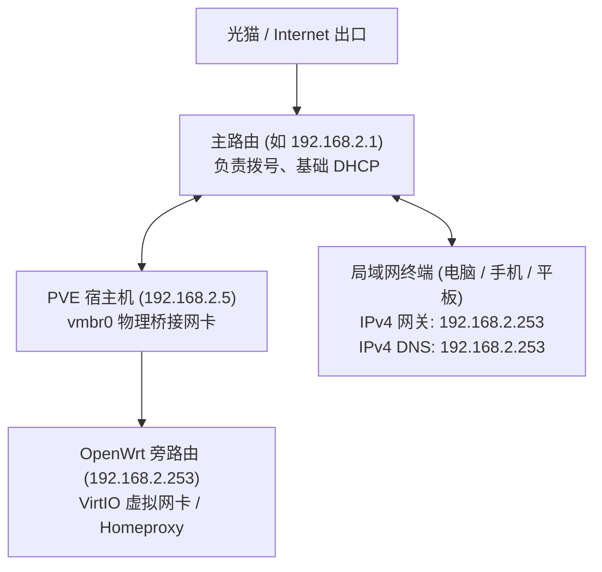

> 本指南基于从 ESXi 迁移至 PVE (Proxmox VE) 部署 OpenWrt 旁路由的实战案例整理，重点梳理网络拓扑、关键防火墙规则（IP 动态伪装 / MSS 钳制）、VirtIO 网卡优化、以及避免 IPv6 泄漏导致 YouTube 后台播放失效和媒体打不开等经典问题。

---

## 一、 网络拓扑与规划

在旁路由（单臂路由）架构中，主路由负责 PPPoE 拨号与 DHCP 基础分配，OpenWrt 作为局域网内的网关和 DNS 代理中继。



### 推荐 IP 规划参考
| 设备名称 | IP 地址 | 网关 | DNS | 说明 |
| :--- | :--- | :--- | :--- | :--- |
| **主路由** | `192.168.2.1` | 上游光猫/ISP | 运营商/公共 DNS | 负责局域网基础交换 |
| **PVE 宿主机** | `192.168.2.5` | `192.168.2.1` | `192.168.2.1` | 方便管理，不走旁路由代理 |
| **OpenWrt 旁路由** | `192.168.2.253` | `192.168.2.1` | `192.168.2.1` | 旁路由单网口接入 `vmbr0` |
| **受纳终端** | `192.168.2.x` | `192.168.2.253` | `192.168.2.253` | 手动或由主路由 DHCP 指定网关 |

---

## 二、 PVE 虚拟机创建规范

1. **虚拟硬件选型**：
   - **架构**：x86_64
   - **CPU**：1~2 核，类型建议选 `host`（性能损耗最小）。
   - **内存**：1024 MB（1 GB 足够绝大多数旁路由及分流插件使用）。
   - **网卡模型**：`VirtIO (paravirtualized)`，桥接到 `vmbr0`（主网卡所在网桥）。
   - **单网口原则**：旁路由**仅需分配一个虚拟网口 (`net0`)** 即可，无需分配多余的网卡，更不要将多块虚拟网口混杂绑定。

---

## 三、 OpenWrt 网络与基础接口配置

### 1. LAN 接口设置
进入 OpenWrt 后台 -> **网络** -> **接口** -> **LAN**（编辑）：
- **协议**：静态地址
- **IPv4 地址**：`192.168.2.253`
- **子网掩码**：`255.255.255.0`
- **IPv4 网关**：`192.168.2.1`（必须指向**主路由**）
- **自定义 DNS 服务器**：`192.168.2.1` 或 `223.5.5.5`（指向主路由或国内公共 DNS，防止插件未启动时旁路由自身断网）

### 2. 关闭 OpenWrt 的 DHCP 服务
旁路由不需要向局域网广播 DHCP，否则会导致内网有两个 DHCP Server 抢答：
- 在 **LAN 接口 -> DHCP 服务器** 中勾选 **忽略此接口**。
- **高级设置** 中将 **动态 DHCP** 取消勾选。
- **IPv6 设置**：路由通告服务（RA）、DHCPv6 服务、NDP 代理全部设为 **已禁用**。

---

## 四、 防火墙关键设置（核心避坑）

> [!IMPORTANT]
> **必须开启 LAN 区域的「IP 动态伪装 (MASQUERADE)」**
> 
> **踩坑原理**：在旁路由单臂模式下，终端发送数据路径为：
> `终端 -> 旁路由 -> 主路由 -> 外网`
> 如果旁路由**未开启 IP 动态伪装**，外网回程数据包返回主路由后，主路由会根据目标 IP **直接将数据包发回给终端**，而不经过旁路由。
> 这会导致非对称路由（Asymmetric Routing），终端收到不是发给它所选下一跳 MAC 的回包，发生 TCP 状态机异常，导致**部分网页打不开、微信图片发不出、文字能刷出但媒体一直转圈**。
> 开启 `masq` 后，经由旁路由发往主路由的数据包源 IP 会被伪装成旁路由自身，确保回程流量原路返回旁路由解封装。

### 1. 开启 IP 动态伪装与 MSS 钳制
进入 OpenWrt 后台 -> **网络** -> **防火墙** -> **常规设置**：
1. 找到 **lan** 区域，点击 **编辑**。
2. 勾选 **IP 动态伪装 (Masquerading)**。
3. 勾选 **MSS 钳制 (MTU Fixing)**。
   > [!NOTE]
   > OpenWrt 默认只在 `wan` 区域勾选 MSS 钳制。但单臂旁路由的流量全部出入自 `lan` 区域，若 `lan` 未开启 MSS 钳制，大包（如图片、视频流、TLS 证书握手）易因超出 PMTU 而发生静默丢包。

命令行快速生效配置：
```bash
uci set firewall.cfg02dc81.masq='1'
uci set firewall.cfg02dc81.mtu_fix='1'
uci commit firewall
/etc/init.d/firewall restart
```

### 2. 避免盲目添加 QUIC (UDP 443) 拦截规则
> [!WARNING]
> 切勿在防火墙自定义规则中盲目加入 `Reject-QUIC-UDP443` 或拦截 UDP 443。
> 许多老教程推荐屏蔽 QUIC 迫使客户端回退到 TCP，但在节点支持 UDP 转发（如 `xudp`、Hysteria 2）的环境下，拦截 QUIC 会向客户端大量回送 `ICMP Port Unreachable`，导致 **YouTube 移动端切后台/锁屏时音频流断开** 或 **X (Twitter) 媒体请求被重置**。

---

## 五、 解决「YouTube 后台播放失效 / X 图片打不开 / V2EX 偶发打不开」

### 1. 故障现象与根因复盘
* **YouTube 后台播放失效**：手机使用同一个代理节点在蜂窝移动网络下后台播放正常，连上 Wi-Fi 后切后台立即暂停/失效。
* **V2EX 偶尔打不开**：报错 `Connection reset by peer`，刷新又正常。
* **X (Twitter) 媒体图片加载断断续续**。

**真正根因**：**IPv6 旁路泄露**！
1. 终端（iPhone / iPad / PC）在 Wi-Fi 中，虽手动指定了 IPv4 网关指向旁路由，但由于主路由开启了 IPv6 RA 广播，终端依然获得了公网 IPv6 地址，且 **默认 IPv6 网关是主路由**。
2. 代理插件（如 Homeproxy / sing-box）默认 DNS 解析策略若为 `prefer_ipv4`，在客户端请求 `AAAA` 记录时仍会返回 YouTube、V2EX 的 IPv6 地址。
3. 客户端操作系统自带 **Happy Eyeballs** 机制，优先尝试 IPv6 连接，流量直接越过旁路由从主路由送往国内 ISP：
   - YouTube 检测到国内真实公网 IPv6，直接吊销该会话的 **YouTube Premium 区域后台播放特权**。
   - V2EX 和 Twitter 的 IPv6 直连海外节点，被 GFW 拦截或直接 TCP Reset。

### 2. 解决方案 A：强制代理插件使用 IPv4-Only 解析（最推荐）
在不需要让旁路由代理 IPv6 的情况下，必须强制代理核心丢弃所有 AAAA 响应。

以 **Homeproxy (sing-box)** 为例，修改配置生成模板 `/etc/homeproxy/scripts/generate_client.uc`：
```javascript
// 将原本的 prefer_ipv4 替换为 ipv4_only
const dns_default_strategy = (ipv6_support === '1') ? 'prefer_ipv6' : 'ipv4_only';
```
修改后重启服务：
```bash
/etc/init.d/homeproxy restart
```
这样终端解析境外域名时永远只拿到 IPv4 地址，全量走旁路由 TUN 分流，彻底杜绝 IPv6 泄漏。

### 3. 解决方案 B：主路由彻底关闭 IPv6
如果局域网内没有必须使用外网直连 IPv6 的应用（如特定 BT 下载或纯 IPv6 穿透），**直接在主路由中关闭 IPv6 的 DHCPv6 / SLAAC (RA) 通告**，这是旁路由网络最纯净、最稳妥的架构。

---

## 六、 PVE VirtIO 虚拟网卡硬件卸载优化

> [!TIP]
> 从 ESXi 迁移到 PVE 后，PVE 的 Linux Bridge (`vmbr0`) 配合 VirtIO 网卡默认会开启大量硬件校验和与分段卸载特性。这极易在旁路由跨接口、TUN 封装转发时引发校验和错误或大包丢弃。

在 OpenWrt 内部执行以下命令关闭硬件卸载：
```bash
ethtool -K eth0 tx off tso off gso off gro off
```

### 持久化配置（防止重启失效）
编辑 `/etc/rc.local`，在 `exit 0` 之前加入：
```bash
ethtool -K eth0 tx off tso off gso off gro off
exit 0
```

---

## 七、 TUN 虚拟网卡 MTU 规整

部分固件或插件（如 Homeproxy / OpenClash）可能会将 TUN 虚拟网卡 MTU 设置为 `9000`（Jumbo Frame），这在物理网卡 MTU 仅为 `1500` 时极易引发数据包分片黑洞。

建议将 TUN MTU 规整为 `1500`：
```bash
uci set homeproxy.infra.tun_mtu='1500'
uci commit homeproxy
/etc/init.d/homeproxy restart
```

---

## 八、 快速故障排查验证清单

完成配置后，在局域网内任意客户端运行以下排查指令进行验证：

```bash
# 1. 验证海外域名是否已完全阻断 IPv6 泄露（期望输出：仅包含 IPv4，无 IPv6 地址）
getent ahosts youtube.com
getent ahosts www.v2ex.com

# 2. 验证海外核心服务 HTTP/2 握手与响应速度（期望输出：HTTP 200，耗时 1s 左右）
curl -sI -o /dev/null -w "HTTP: %{http_code}, Time: %{time_total}s\n" https://www.youtube.com
curl -sI -o /dev/null -w "HTTP: %{http_code}, Time: %{time_total}s\n" https://www.v2ex.com
curl -sI -o /dev/null -w "HTTP: %{http_code}, Time: %{time_total}s\n" https://x.com

# 3. 验证国内流量分流直连（期望输出：HTTP 200，耗时 0.1s 左右极速直连）
curl -sI -o /dev/null -w "HTTP: %{http_code}, Time: %{time_total}s\n" https://www.baidu.com
curl -sI -o /dev/null -w "HTTP: %{http_code}, Time: %{time_total}s\n" https://www.bilibili.com
```
