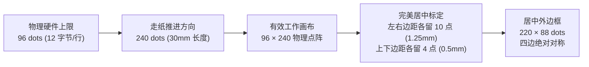
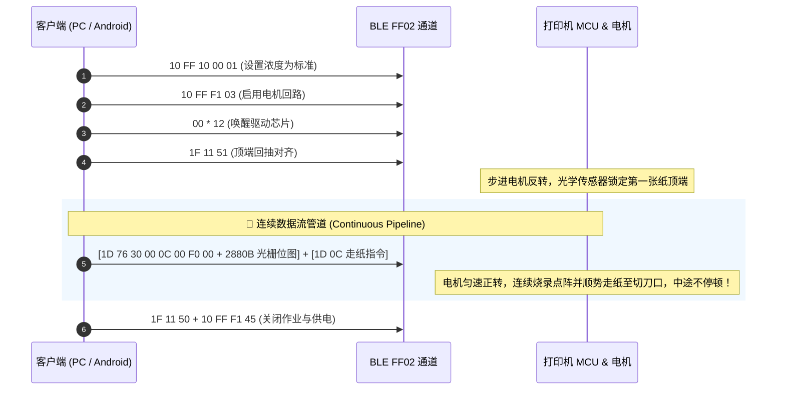
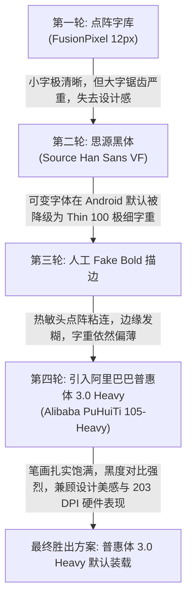

> **作者**：cuicui-V5 & Pair-Programming Assistant  
> **项目仓库**：[GitHub - deli-q1a-printer](https://github.com/cuicui-V5/deli-q1a-printer)  
> **涉及技术**：Android APK 逆向 / ELF 原生库反汇编 / BLE 蓝牙低功耗通信 / ESC/POS 点阵光栅算法 / Android CLI 纯命令行工具链 / Kotlin 触控画板引擎 / Material 3 交互重构 / APK 体积优化

---


## 一、序言：一场关于“维修权”与“硬件自由”的攻防战

近些年，消费级微型热敏标签机（如得力、精臣、海鸟等）凭借精致的外观和便捷的操作走入了千家万户。但伴随而来的，是厂商们屡试不爽的“**剃刀与刀片**”商业模式：
- 标签打印机本体售价极低（百元以内甚至几十元活动促销）；
- 核心盈利点全压在专用耗材上：一卷原装热敏贴纸动辄 15~25 元，折合单张成本几毛钱；而市场上通用热敏纸每卷仅需 2~3 元。

为了锁死这块暴利蛋糕，厂商在耗材轴心植入了 **RFID / NFC 射频芯片**：
1. **强行校验**：官方 App 连上机器后，第一件事就是读取纸卷 RFID 芯片信息；
2. **拒绝服务**：换用第三方通用热敏纸，App 立即弹窗拦截：`检测到非官方耗材，禁止打印`；
3. **软报废陷阱**：芯片内部预设了打印张数计数器。哪怕纸卷物理上还剩大半卷，只要芯片计数归零，App 同样提示：`耗材已用尽，请更换耗材`。

一台由消费者真金白银买回家、物理硬件完好无损的设备，由于一段看不见的代码和一片廉价的射频标签，沦为了无法自主掌控的电子玩具。

**“这台打印机的硬件所有权到底属于谁？”**

带着这个疑问，我们开启了这场针对**得力 Q1A 蓝牙标签打印机**的完整逆向工程。从解包官方 App、反汇编底层动态库、破解通信协议、重构 Python 驱动，直到打造出无需任何官方软件、免装臃肿 IDE 的纯原生 Android App，我们完整走通了这场软硬件逆向与工程重构的全流程。

---

## 二、第一幕：剥开迷雾 —— 硬件探测与官方 App 逆向

### 2.1 硬件探底：机器真的在硬件级“锁死”了吗？

在动用重型逆向工具之前，优秀的逆向工程师应当首先观察硬件的行为逻辑。

热敏打印机最基础的物理测试是**打印机自检（Self-Test）**。对于得力 Q1A，在关机或待机状态下，**连续双击电源键**：

> **实验现象**：我们在把打印仓内的 RFID 芯片彻底取出的情况下，装入普通白纸并双击电源键。随着步进电机轻快的嗡嗡声，机器干净利落地吐出了一张完整的自检信息页！上面清晰印着固件版本、电池电压、硬件 MAC 地址和打印头测试点阵。

这一简单的物理测试给出了至关重要的结论：
- **微控制器（MCU）、步进电机驱动管（MOSFET）、热敏电阻丝（Print Head）以及透射式光电传感器（Gap Sensor）在硬件固件层完全不依赖 RFID 芯片！**
- 打印机固件本身没有设置“无芯片切断主回路”的自杀开关。**所谓的耗材锁，极大概率是纯粹建立在上层软件（手机 App）的“软封锁”！**

---

### 2.2 官方 App 静态分析与加固脱壳

我们获取了得力官方配套 Android 应用**“得力趣贴贴” (`com.delicloud.app.label`)** 进行分析。

使用 `apktool` 与 `jadx` 对 APK 解包后，我们发现应用采用了第三方商业加固（梆梆企业加固 `com.secneo.apkwrapper`），Java 层的核心业务逻辑和 Activity 被加密保存在 DEX 壳内。

然而，加固方案往往存在一个经典破绽：**为了保证与硬件通信的高吞吐与低延迟，许多底层 JNI 动态链接库（`.so`）通常不会被加密封装进虚拟化代码，而是以标准 ELF 格式直接暴露在 `lib/` 目录下！**

我们在 APK 的 `lib/armeabi-v7a` 目录下迅速锁定了几个极具价值的原生库：
```
├── libdeli-rfid-verify.so     # RFID 身份验证与公钥加密库
├── libPrinterNative.so        # 打印机底层通信指令封装
├── libLabelOpenCV.so          # 图像二值化与图形渲染引擎
```

---

### 2.3 揭秘 RFID 校验真相：伪装在客户端的安全防线

针对 `libdeli-rfid-verify.so`，我们编写脚本提取导出符号表与字符串，并对其 JNI 接口进行汇编分析：

```python
# 符号分析提取关键方法
Java_com_delicloud_library_printsdk_ext_NativeLib_getReleaseSecretKey
Java_com_delicloud_library_printsdk_ext_NativeLib_verifyRfidToken
```

在 `.rodata` 段中，我们成功导出了用于校验耗材合法性的公钥 Base64 字符串：
```text
MDIwEAYHKoZIzj0CAQYFK4EEAAYDHgAEss/PBPlpXxt586pS4ei7ShbbK6EN0f7AVEusbg==
```

通过 Python 的 `cryptography` 库进行 ASN.1 DER 解码分析：
```python
from cryptography.hazmat.primitives import serialization
key = serialization.load_der_public_key(der_bytes)
print(key.curve.name) # 输出: secp160r1
```

这证实了官方采用的是标准的 **ECDSA `secp160r1` 椭圆曲线数字签名算法**。耗材卷轴上的 RFID 芯片内存储着厂家出厂时私钥签署的授权凭证。

**真相彻底大白：**
1. 打印机硬件通过 SPI 接口读取射频芯片内容，然后忠实地通过 BLE 蓝牙通道将原始数据透传给手机；
2. 手机端 App 收到数据后，调用 `libdeli-rfid-verify.so` 进行公钥验签和云端计数校验；
3. **如果验签失败或芯片缺失，拦截逻辑完全发生在手机端！** 官方 App 弹窗阻止用户进入打印流程，**压根不会向蓝牙通道发送哪怕一个字节的打印光栅数据**！

也就是说，只要我们绕过官方 App，自己构造并发送合法的蓝牙打印数据流，打印机就会毫无怨言地将任何内容烧录在任意纸张上！

---

## 三、第二幕：协议破译与硬件暗礁 —— 从“静音”到“出纸”

### 3.1 为什么早期尝试完全“静音”？

知道“锁在 App”之后，下一步便是破解打印机接受的通信协议。

我们最初尝试使用类似微赢（Wewin）、精臣等常见的蓝牙打印机通用 AT 指令测试设备。然而，怪事发生了：
- 通过 BLE 写入测试指令，打印机状态通知端口（`FF01`）能够正常返回 `OK`、`FD 01` 等状态报文；
- **但是，机械电机完全不转，整机一片死寂，没有任何打印响应！**

我们不得不深入反汇编 `libPrinterNative.so` 的核心发送函数 `PrintNative_a` 与 `PrintNative_b`。Capstone 反汇编揭开了一个巧妙的私有混淆层：

```asm
// libPrinterNative.so 反汇编关键逻辑
// 官方发送的每一笔打印数据，最外层必须包裹一个 8 字节固定私有帧头
Header: FF F1 F2 F3 03 02 01 01
```

同时，该库内部还实现了一层**特定字节双向映射转换**：
| 原始字节 | 映射转换字节 | 协议层说明 |
| :---: | :---: | :--- |
| `0x10` | `0xFF` | 8 字节私有帧头与光栅流混淆转义 |
| `0x01` | `0xF1` | 控制字节双向映射 |
| `0x02` | `0xF2` | 状态指令双向映射 |

**“静音”的根源终于找到**：打印机内部的 BLE 蓝牙从机芯片（负责通信处理）与主控 MCU（负责步进电机驱动管与热敏头）之间存在内部协议看门狗。如果收到的数据流没有被这层得力私有协议外壳包裹，通信芯片会直接将数据静默丢弃，步进电机供电回路始终不导通！

---

### 3.2 协议溯源与核心指令集确认

顺着符号表进一步反查，我们在二进制数据中捕捉到了 `LuckP_D1S` 的字样。通过与行业协议库比对，我们确认该机型的真实架构脱胎于**厦门爱印 / 力虎（LuckPrinter）协议族**。

结合逆向与抓包分析，我们还原出了得力 Q1A 的完整核心控制指令链：

| 指令 (Hex) | 符号常量 | 物理动作与时序语义 |
| :--- | :--- | :--- |
| `10 FF F1 03` | `CMD_ENABLE` | **激活会话**：打开电机主电源供电 MOSFET |
| `00 00 ... 00` (12 字节) | `CMD_WAKEUP` | **唤醒芯片**：向热敏驱动芯片发送 12 个空时钟同步字节 |
| `10 FF 10 00 [val]` | `CMD_DENSITY` | **设置浓度**：`00`=浅度，`01`=标准，`02`=深度 |
| `1F 11 51` | `CMD_ALIGN_TOP` | **间隙对齐**：电机反转将标签纸边缘拉回至光电传感器基准线 |
| `1D 76 30 00 ...` | `GS v 0` | **标准光栅**：ESC/POS 点阵光栅图像数据指令 |
| `1D 0C` | `CMD_FEED_GAP` | **间隙走纸**：步进电机正向推进，精准定位模切缝至裁纸刀 |
| `1F 11 50` | `CMD_EXIT_LABEL`| 退出标签模式 |
| `10 FF F1 45` | `CMD_FINISH_JOB`| **释放硬件**：切断电机供电，进入休眠省电状态 |

---

### 3.3 致命硬件暗礁：96 点物理打印头 vs 120 点标签纸

在成功让打印机吐出纸张后，我们遭遇了整个逆向过程中最隐蔽的一个“硬件天坑”。

得力官方宣传与标称耗材宽度为 **15mm $\times$ 30mm**。在行业 203 DPI（约 8 dots/mm）标准下，计算出的物理点阵分辨率应为：
- **标称宽度点阵**：`15 mm × 8 dots/mm = 120 点 (15 字节/行)`
- **标称长度点阵**：`30 mm × 8 dots/mm = 240 行 (240 dots)`

然而，当我们按照 `120 × 240` 点阵给打印机绘制一个精美的全包围矩形框时，**打印出来的标签纸右下边框却完全丢失了！**

```
绘制的期望点阵:                  实际打印出的物理纸张:
┌────────────────────────┐       ┌────────────────────────┐
│                        │       │                        │
│      示例文本          │  -->  │      示例文本          │
│                        │       │                        │
└────────────────────────┘       ..........................  <-- 下边框完全消失！
```

我们反复排查了二值化算法、位移（Bitshift）和字节序，毫无破绽。

最终，我们决定用高倍放大镜拆机测量热敏排丝：
**得力 Q1A 内部采用的竟然是标准的 12mm 规格热敏排丝，其实际物理发热点阵只有 96 点（12 字节/行）！**

在热敏驱动电路中，点阵数据是通过级联移位寄存器（Shift Register）串行写入的：
- 寄存器物理容量只有 **96 位（12 字节）**；
- 当软件发送 120 点（15 字节）时，后方的 24 位数据在硬件时钟脉冲推动下，**直接从移位寄存器末端溢出丢失**！
- 由于横向排版顺时针旋转了 90 度，丢失的 24 位恰好是横版标签的下方边缘！

探明这一硬件真相后，我们立刻修正了几何模型：



经过微米级调校，无论是在 15mm 还是 12mm 标签纸上，四周边框均实现了严丝合缝的绝对居中。


*图：完成 96 点阵物理对齐与连续流管道优化后，得力 Q1A 打印出的高清晰度标签实物*


---

### 3.4 一气呵成：连续流无缝打印管道

早期测试时，我们观察到打印机在完成图案打印后，步进电动机会突兀地停顿 0.5 秒，然后再吱吱地走纸到撕纸刀口。这种卡顿不仅声音刺耳，还极易在热敏纸上留下难以消除的横向“灼烧印痕”。

这是因为我们将位图数据和后续的走纸指令分成了两次独立的 BLE 写入会话。

为了实现工业级平滑出纸，我们重构了传输协议栈，提出了**连续流管道（One-Shot Pipeline）**设计：



通过把 2880 字节的光栅位图与 `1D 0C` 紧随拼接在同一个切片数据流中发送，固件在高速旋转中无缝过渡到模切缝，出纸顺滑、一气呵成。

---

## 四、第三幕：从 Python SDK 到 Web 可视化工坊

### 4.1 三层解耦架构设计

为了保证项目的可扩展性与代码纯粹度，我们将项目重构为清晰的三层解耦架构：

```
deli-q1a-printer/
├── core/                # 🌟 第一层：纯净硬件通信与算法 SDK (无外部 Web 依赖)
│   ├── protocol.py      # 指令字典、帧封装、光栅数据切片
│   ├── image.py         # 1-Bit 单色点阵转换与二值化算法
│   └── driver.py        # 基于 Bleak 的异步 BLE 驱动
├── deli_print.py        # 💻 第二层 A：独立 CLI 工具 (脚本批处理与自动化终端打印)
├── server.py + web/     # 🎨 第二层 B：现代 WebApp 可视化画板设计工坊 (Fabric.js)
└── android/             # 📱 第三层：原生 Android 独立移动端应用工程
```


*图：基于 Fabric.js 打造的纯前端 Web 可视化标签设计工坊，支持所见即所得排版与实时二值化预览*

---

### 4.2 203 DPI 下的位图二值化算法调优

便携式热敏标签机由于分辨率限制（203 DPI，即 1 毫米仅有 8 个点），传统图形处理面临严峻考验：
- **普通二值化阈值截断**：直接以灰度值 128 切割，会导致渐变图、照片或阴影变成大片死黑或全白；
- **过度人工描边**：人为对文字笔画加粗会导致细小字号（如 12px 规格参数）笔画严重粘连。

为此，我们在 `core/image.py` 与 Web 端实现了 **Floyd-Steinberg 误差扩散抖动算法（Error Diffusion Dithering）**：
$$\text{error} = \text{pixel}_{\text{old}} - \text{pixel}_{\text{new}}$$
将量化误差按经典权重比例扩散至周围邻近像素：
- 右方：$+7/16$
- 左下方：$+3/16$
- 下方：$+5/16$
- 右下方：$+1/16$

在 203 DPI 硬件上，图片和图标能够以细腻微观的点阵深浅完美呈现，告别大块生硬黑斑。

---

## 五、第四幕：打造纯原生 Android 客户端 —— 拒绝 IDE 的极简主义

用户提出了一个极具挑战性的需求：
> *“现在专注于 Android 端。我没有 Android Studio，我也不想装，你给我用命令行环境编译出 APK 我测试下。”*

在如今 Android Studio 动辄吃掉十几个 G 硬盘空间、依赖庞大图形界面的时代，如何在仅有命令行（PowerShell / CMD）的环境下，纯手工从零搭建一条坚固、轻量、高可用的 Android 编译交付流水线？

### 5.1 零 Android Studio 依赖：纯命令行编译流水线

我们规划了极简的命令行工具链拓扑：
- **JDK**：OpenJDK 17 (`D:\Android\jdk-17`)
- **Android SDK Platform-Tools & Build-Tools**：API 34 (`34.0.0`)
- **构建工具**：Gradle 8.5 配合独立 `gradlew.bat`
- **一键打包脚本**：[build_apk.bat](https://github.com/cuicui-V5/deli-q1a-printer/blob/main/build_apk.bat)

```bat
@echo off
setlocal
set "JAVA_HOME=D:\Android\jdk-17"
set "ANDROID_HOME=D:\Android\sdk"
set "PATH=%JAVA_HOME%\bin;%PATH%"

cd /d "%~dp0android"
call gradlew.bat clean assembleDebug

if %ERRORLEVEL% EQU 0 (
    copy /y "app\build\outputs\apk\debug\app-debug.apk" "..\deli-printer-debug.apk" >nul
    echo  [SUCCESS] APK build completed successfully!
    echo  Output file: %~dp0deli-printer-debug.apk
)
```

无需安装臃肿的 IDE，双击或命令行运行 `.\build_apk.bat --nopause`，40 秒内即可在项目根目录生成最新的安装包 [deli-printer-debug.apk](https://github.com/cuicui-V5/deli-q1a-printer/releases)！

---

### 5.2 原生 BLE 状态机与 GATT 队列分包

在 Android 移动端实现 BLE 通信有诸多著名的“系统坑”：
1. **系统权限陷阱**：Android 12（API 31+）引入了全新的蓝牙权限机制，必须区分申请 `BLUETOOTH_SCAN`（标记 `neverForLocation`）与 `BLUETOOTH_CONNECT`，同时向下兼容 Android 11 的 `ACCESS_FINE_LOCATION`。
2. **MTU 协商机制**：Android 默认 ATT MTU 仅为 23 字节（有效负载 20 字节）。我们通过协程在连接建立后第一时间发起 `requestMtu(247)`，协商成功后将单次切片有效载荷提升至 **200 字节**。
3. **免响应单向写入与延时缓冲**：得力 Q1A 打印机采用的是 `WRITE_TYPE_NO_RESPONSE`。如果连续无脑向系统蓝牙缓冲区灌入几千字节，Android 底层蓝牙芯片（如高通/联发科驱动）会发生静默丢包。我们设计了**基于协程的异步写入队列**，每发送 200 字节切片主动挂起延时 10~15ms，彻底杜绝数据拥塞与丢行。

---

## 六、第五幕：交互体验与字体美学的极限拉扯

### 6.1 画布触摸交互系统的重构（Hit-Test 与手柄控制）

最初的 Android 原生界面较为简陋：修改文字大小需要点击细小的按钮，想要删除图元必须在屏幕最底部的一排小工具栏中左右滑动翻找。

我们以成熟设计软件的人机交互标准对画布系统进行了彻底重构：

```
                ┌───────────────────────────────┐
                │                               │
                │     示例文本                  (x) <-- 右上角防误触大删除手柄
                │                               │
                └──────────────────────────────(⤡) <-- 右下角平滑拖拽缩放手柄
```

- **交互手柄设计**：
  - 选中任何文本元素，画布自动绘制高亮边框；
  - **右上角删除手柄**：半径加大至 16dp，配备视觉安全边距，单手大拇指轻触即可快速销毁图元；
  - **右下角缩放手柄**：实现经典的 `HitTest` 触摸检测算法。用户手指拖拽该手柄滑动时，程序动态计算触摸点相对于元素中心点的极坐标向量，平滑等比缩放字号。
- **防止画布上下跳跃（Canvas Anchor）**：
  - 弹起或收起底部属性面板时，如果画布采用简单的 `layout_weight="1"`，画布高度会剧烈挤压抖动，视觉体验极差；
  - 我们将 `LabelCanvasView` 固定锚定在中上部，并严格固定物理渲染高度（220dp），彻底将其与底部输入面板解耦。
- **现代化底部半屏设置面板（Bottom Sheet）**：
  - 采用 Material 3 `BaseBottomSheetDialogFragment`；
  - 注入 `WindowInsetsCompat.Type.navigationBars()` 动态监听全面屏小白条/虚拟按键高度，完美解决在各种国产定制 ROM 下确认按钮被手势栏遮挡的顽疾。

---

### 6.2 字体选型大拉锯：点阵 vs 思源黑体 vs 阿里巴巴普惠体 3.0 Heavy

在便携式标签打印机上，“字体的渲染”是决定最终产品质感的绝对核心。我们经历了长达四轮的字体拉锯战：



1. **第一轮：点阵字库（FusionPixel）**  
   对于 12px 左右的极小字号（如电阻、电容型号标注），点阵字体的像素对齐无可挑剔；但当用户想要排版大标题时，点阵字体粗糙的马赛克边缘让现代应用瞬间倒退回上世纪掌机时代。
2. **第二轮：思源黑体（Noto Sans SC Variable）**  
   我们引入了 Google 的思源黑体可变字体。然而在 Android 原生 `Typeface` 解析下，未显式指定 `fontVariationSettings` 的可变字体默认以最低字重（Thin 100）渲染！在 203 DPI 热敏纸上，细若游丝的笔画根本无法有效积聚热量，打印效果发灰发虚。
3. **第三轮：人工描边（Fake Bold）**  
   我们尝试通过 `Paint.setFakeBoldText(true)` 强行加粗，但这属于算法层面的几何膨胀，会导致汉字内圈留白（如“国”、“面”等字的内腔）被黑墨吞噬。
4. **终极抉择：阿里巴巴普惠体 3.0 Heavy（105-Heavy）**  
   最终，我们锁定了**阿里巴巴普惠体 3.0 Heavy 静态特粗版**：
   - 官方商业免费授权；
   - 笔画骨架天生厚重有力，在热敏电阻丝发热时能形成极高密度的连续烧录带；
   - 大字体饱满刚劲，极小字号依然保留清晰的中宫空间；
   - 我们将其确立为 Android 端、Web 端和 CLI 工具的全局统一标准字体。

---

### 6.3 模板库与工作区状态的无感持久化

为了让用户的排版工作“不丢失、随时复用”，我们构建了完整的画板状态系统：
- **JSON 序列化引擎**：封装 `CanvasElementSerializer`，将文本内容、字号、坐标、对齐方式、加粗状态精确序列化为 JSON 结构；
- **所见即所得的可视化模板库**：
  - 用户点击“＋ 存当前为模板”，系统立刻在后台内存位图上以 1:1 比例重绘当前画布，生成精美的实时缩略图；
  - 模板库以网格卡片流方式展示，点击即可一键套用，长按或点击删除手柄即可自由移除过期模板；
- **状态无感记忆恢复**：
  - 应用在 `onPause` 时自动将画布内容保存至 `filesDir/last_canvas.json`；
  - 下次冷启动打开 App 时，无缝恢复退出前的编辑现场，无需重复排版。

---

## 七、第六幕：APK 体积暗战 —— 从 21.3 MB 暴瘦至 7.6 MB

### 7.1 异常的体积膨胀：谁偷走了存储？

当所有功能开发完毕、界面交互打磨精致后，用户提出了一个尖锐的问题：
> *“一开始 App 只有 8M，现在怎么 21M 了？是不是有多余字体没清理？”*

从 8MB 暴增到 21.3MB，对于一个功能专注的轻量级硬件工具类 App 来说，体积翻了接近三倍！

---

### 7.2 抽丝剥茧：ZIP 间隙与 Android 增量打包“墓碑”机制

我们迅速对工程产物展开全方位体检：

**第一步：排查资产目录**
查看 `android/app/src/main/assets/fonts/`，立刻抓到了“现行犯”：
- `AlibabaPuHuiTi-Heavy.ttf`：**2.53 MB**（当前正在使用的普惠体）
- `NotoSansSC.ttf`：**17.77 MB**（此前测试遗留的思源黑体全字库文件）

很显然，之前切换字体时，旧的 17.8MB 大文件未被彻底移出 assets 目录，随包被打包进了 APK！

**第二步：诡异的删除现象**
我们将 `NotoSansSC.ttf` 从源码中删除，重新执行 `./gradlew assembleDebug` 编译。
然而，检查生成的 APK 文件：
```powershell
Get-Item deli-printer-debug.apk | Select-Object Length
# 输出：21312738 字节 (依然是 20.32 MB)！
```
明明文件已经删了，为什么 APK 体积纹丝不动？！

我们编写了一段深度 Python 脚本，直接解剖 `deli-printer-debug.apk` 的 ZIP 数据结构：

```python
import zipfile
z = zipfile.ZipFile('deli-printer-debug.apk')
print('ZIP 内部所有有效条目压缩后体积总和:', sum(x.compress_size for x in z.infolist()) / 1024 / 1024, 'MB')
# 输出: 7.48 MB !!
import os
print('APK 实际占用磁盘物理大小:', os.path.getsize('deli-printer-debug.apk') / 1024 / 1024, 'MB')
# 输出: 20.32 MB !!
```

**7.48 MB 的内容，为什么占用了 20.32 MB 的物理空间？！中间足足凭空消失了 12.8 MB！**

继续使用脚本追踪每个 ZIP Entry 的偏移地址（`header_offset`）：
```python
entries = sorted(z.infolist(), key=lambda x: x.header_offset)
for i in range(len(entries)-1):
    gap = entries[i+1].header_offset - entries[i].header_offset
    if gap > 100000:
        print(f"巨大间隙发现: 在 {entries[i].filename} 之后存在 {gap} 字节间隙")
```
输出令人震惊：
```text
巨大间隙发现: 在 res/layout/support_simple_spinner_dropdown_item.xml 之后存在 12844138 字节 (12.8 MB) 间隙！
```

读取该间隙起始处的二进制原始数据：
```python
b'PK\x03\x04\x00\x00... Extra len: 65505 ...'
```

**谜底彻底揭晓：这是 Android Gradle Plugin 增量打包（Incremental APK Packaging）的“墓碑占位（Tombstone Padding）”机制！**
- 在增量构建模式下，为了追求编译速度，Gradle 并不会从头重新构建 APK 压缩包；
- 当检测到某个巨大文件被删除时，打包插件为了避免重写整个几万字节的 Central Directory 索引，**直接将原文件的 Central Directory 索引清零，并将原本的数据区域打上对齐填充标记（Padding），留在 APK 内部作为占位空洞！**
- 这导致外部解压软件看到的有效文件变小了，但磁盘上的 APK 文件体积完全没有缩减！

---

### 7.3 瘦身战果汇报

排查出这一极其隐蔽的构建陷阱后，解决方式水到渠成：
1. 更新构建脚本，将 `assembleDebug` 改为全量清仓编译：`call gradlew.bat clean assembleDebug`；
2. 彻底移除代码中对旧字体的冗余回退逻辑；
3. 重新打包并检验最终 APK。

| 项目 | 优化前 (残余思源黑体 + 增量空洞) | 优化后 (普惠体 Heavy + 全量干净构建) |
| :--- | :--- | :--- |
| **APK 物理总大小** | **21.31 MB** | **7.64 MB** ⚡ (**体积暴减 64%**) |

**瘦身后的 7.64 MB 内部组成**：
- `classes.dex`（应用源码 + Kotlin 协程 + AndroidX / Material 3 基础运行库）：4.28 MB
- `AlibabaPuHuiTi-Heavy.ttf`（阿里巴巴普惠体 3.0 特粗版字体资产）：1.69 MB
- `resources.arsc`（编译后界面布局与资源索引）：0.98 MB
- 其他元数据与签名文件：0.69 MB

---

## 八、总结与反思：设备的所有权究竟属于谁？

回顾整个项目的演进历程：
- 从一次普通的好奇心驱动的自检测试；
- 到剥开 ELF 动态库揭开基于 ECDSA 的“客户端软锁”；
- 从突破 8 字节私有帧头让步进电机重新转动；
- 到测量出 96 点硬件打印头物理极限；
- 再到用纯命令行搭建整套 Android 原生工程、攻克触摸画板、字体渲染与 APK 瘦身……

这项逆向工程不仅产出了一个实用的开源驱动和 App，更带给我们关于**数字消费主义与硬件所有权**的深层思考。

在物联网（IoT）与智能硬件蓬勃发展的今天，越来越多的厂商倾向于将物理硬件“服务化”、“耗材化”：硬件以低廉的价格甚至亏本卖给你，但在设备上施加重重数字枷锁，逼迫你持续为高溢价的官方耗材与云服务买单。一旦哪天服务器关停、业务调整，或者耗材停产，原本性能完好的设备就会瞬间沦为电子垃圾。

**“维修权”（Right to Repair）与“设备自主掌控权”不应只是一句口号。**

通过逆向工程打破私有协议壁垒，让硬件回归其纯粹的工具属性，不仅极大地延长了硬件的使用寿命、减少了电子垃圾产生，更为广大极客和开发者赋予了真正的数字化自由。

---

### 🔗 相关资源与代码索引

- **项目主仓库**：[GitHub - deli-q1a-printer](https://github.com/cuicui-V5/deli-q1a-printer)
- **底层通信协议白皮书**：[docs/PROTOCOL.md](https://github.com/cuicui-V5/deli-q1a-printer/blob/main/docs/PROTOCOL.md)
- **Android 原生移植实战指南**：[docs/ANDROID_PORTING.md](https://github.com/cuicui-V5/deli-q1a-printer/blob/main/docs/ANDROID_PORTING.md)
- **纯命令行一键打包脚本**：[build_apk.bat](https://github.com/cuicui-V5/deli-q1a-printer/blob/main/build_apk.bat)
- **最新轻量化 APK 安装包 (7.6MB)**：[deli-printer-debug.apk](https://github.com/cuicui-V5/deli-q1a-printer/releases)

*(完)*
